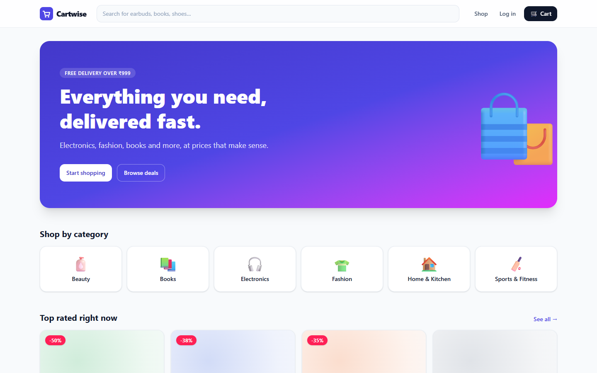
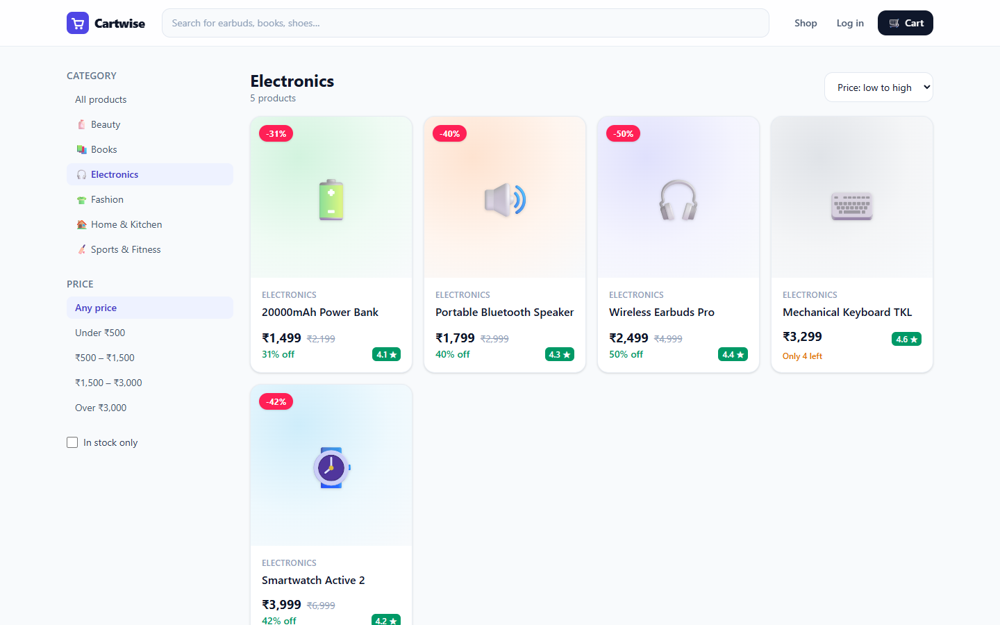
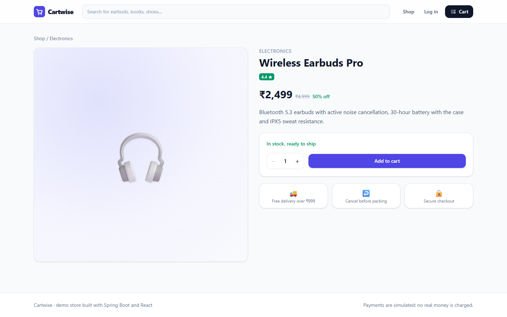
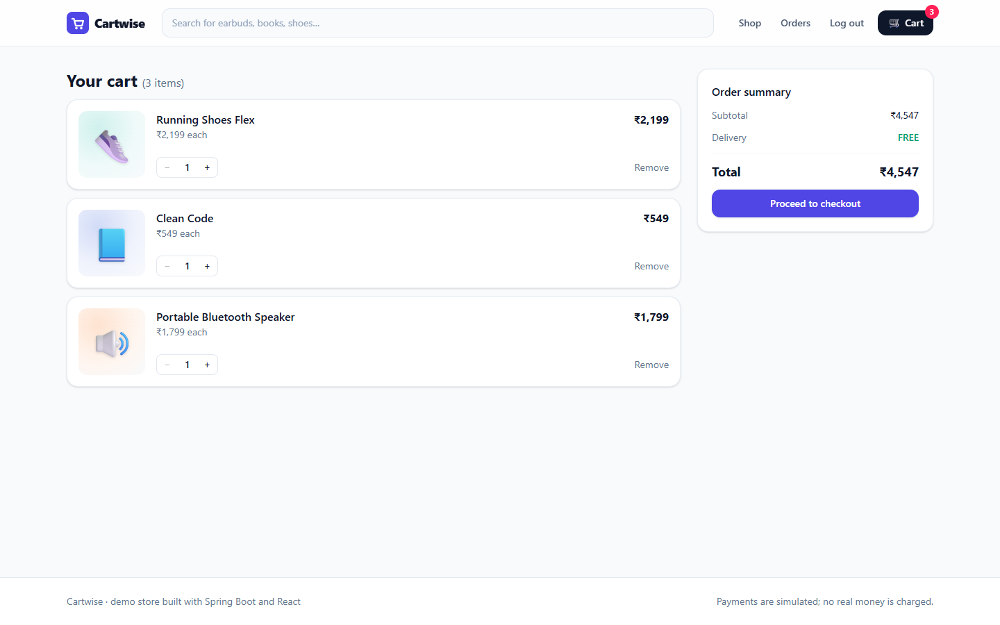
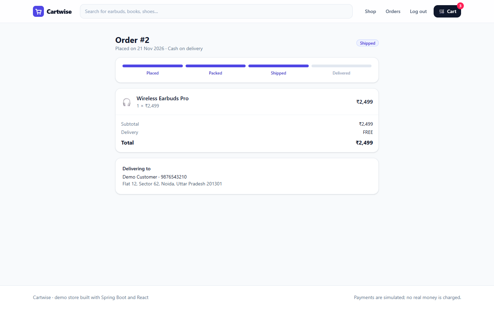
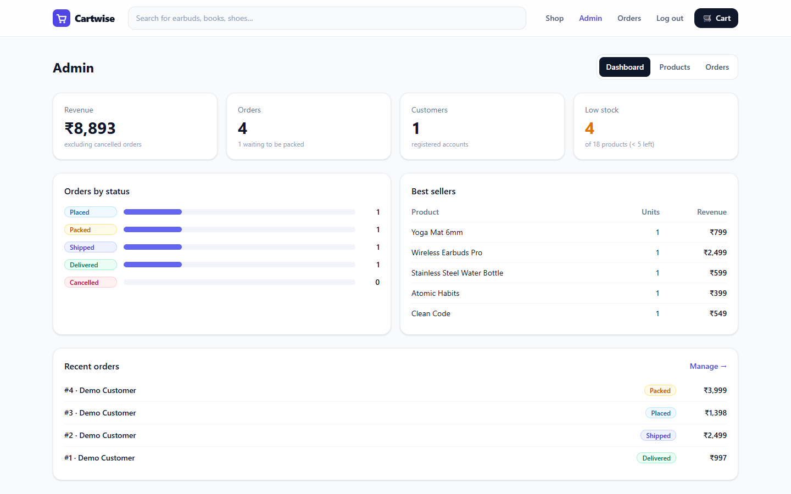
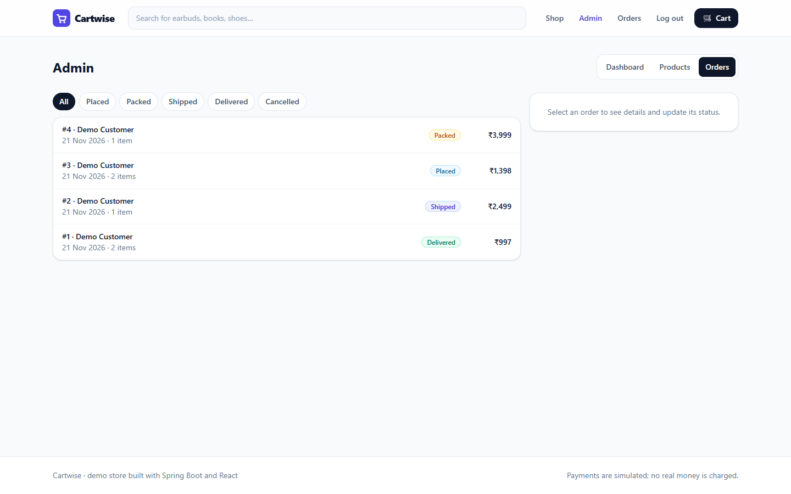
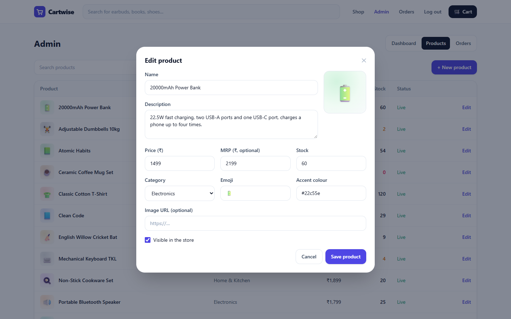
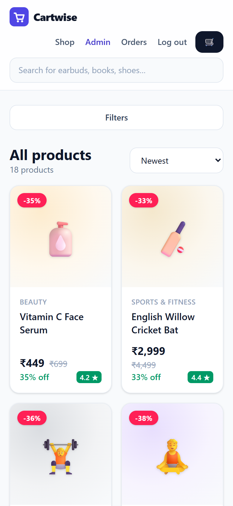

# Cartwise: Full Stack E-Commerce Store

A complete online store built with **Java 21 + Spring Boot 4** and **React 19 + TypeScript**: product catalog with search and filters, cart, checkout with real stock handling, order tracking, and an admin dashboard to manage products and orders.

**Live demo:** https://web-production-0b593347.up.railway.app · **API docs:** https://api-production-ab7d6609.up.railway.app/swagger-ui.html

Log in with `demo@cartwise.dev` / `Demo@1234` (customer) or `admin@cartwise.dev` / `Admin@1234` (admin).



## Features

**Storefront**
- Product catalog with search, category and price filters, "in stock only", sorting and pagination
- Product pages with discount pricing, ratings and low-stock warnings
- Cart with quantity limits, live totals and a free-delivery threshold (₹999)
- Checkout with address validation (10-digit mobile, 6-digit PIN code) and demo payment options (UPI demo / cash on delivery)
- Order history with a status timeline; customers can cancel an order until it is packed

**Admin dashboard**
- Revenue, order, customer and low-stock stats, orders by status, best sellers
- Create and edit products (price, MRP, stock, category, visibility)
- Move orders through `PLACED → PACKED → SHIPPED → DELIVERED`, or cancel them (stock is returned)

**Engineering details**
- Stateless **JWT authentication** (Spring Security OAuth2 resource server, HS256) with `CUSTOMER` and `ADMIN` roles
- **No overselling**: checkout locks product rows (`PESSIMISTIC_WRITE`) in a fixed order, so two buyers can never take the last unit and checkouts cannot deadlock
- **Price snapshots**: each order line stores the name and price at purchase time, so editing a product never changes past orders
- Money as `BigDecimal` end to end; one shared shipping rule for the cart preview and checkout
- Order status changes follow an explicit state machine; invalid jumps (e.g. `PLACED → DELIVERED`) return `409 Conflict`
- Customers get `404` for other customers' orders, so order ids are not leaked
- Consistent JSON errors with per-field validation messages, shown inline in the UI
- **21 integration tests** (MockMvc + real database) covering auth, filters, cart limits, checkout, cancellation, privacy and admin permissions
- OpenAPI / Swagger UI documentation

## Screenshots

| Shop with filters | Product page |
|---|---|
|  |  |

| Cart | Order tracking |
|---|---|
|  |  |

| Admin dashboard | Admin: manage orders |
|---|---|
|  |  |

| Admin: edit product | Mobile |
|---|---|
|  |  |

## Tech stack

| Layer | Technology |
|---|---|
| Backend | Java 21, Spring Boot 4.1, Spring Web MVC, Spring Security (OAuth2 resource server, JWT), Spring Data JPA / Hibernate, Bean Validation |
| Database | H2 (in-memory, zero setup) or PostgreSQL |
| API docs | springdoc-openapi (Swagger UI) |
| Frontend | React 19, TypeScript, Vite, Tailwind CSS 4, TanStack Query, React Router |
| Testing | JUnit 5, Spring Boot Test, MockMvc |

## Run it locally

Requirements: **JDK 21+** and **Node.js 20+**. Maven is not needed; the wrapper downloads it.

```bash
# 1. API on http://localhost:8080
cd backend
./mvnw spring-boot:run        # Windows: mvnw.cmd spring-boot:run

# 2. Frontend on http://localhost:5173 (in a second terminal)
cd frontend
npm install
npm run dev
```

Open http://localhost:5173. The database is seeded with 18 products, 3 sample orders and two demo accounts:

| Role | Email | Password |
|---|---|---|
| Customer | `demo@cartwise.dev` | `Demo@1234` |
| Admin | `admin@cartwise.dev` | `Admin@1234` |

API docs: http://localhost:8080/swagger-ui.html

### Using PostgreSQL

```bash
cd backend
DB_URL=jdbc:postgresql://localhost:5432/cartwise DB_USER=cartwise DB_PASSWORD=cartwise \
CARTWISE_JWT_SECRET=a-long-random-secret-of-at-least-32-bytes \
./mvnw spring-boot:run -Dspring-boot.run.profiles=postgres
```

### Run the tests

```bash
cd backend
./mvnw test
```

## API overview

| Method | Endpoint | Access | Description |
|---|---|---|---|
| POST | `/api/auth/register` | public | Create a customer account, returns a JWT |
| POST | `/api/auth/login` | public | Log in, returns a JWT |
| GET | `/api/auth/me` | user | Current user |
| GET | `/api/categories` | public | All categories |
| GET | `/api/products?q=&category=&minPrice=&maxPrice=&inStock=&sort=&page=&size=` | public | Search the catalog |
| GET | `/api/products/{slug}` | public | Product details |
| GET | `/api/cart` | user | Cart with totals |
| POST | `/api/cart/items` | user | Add a product |
| PUT / DELETE | `/api/cart/items/{productId}` | user | Change quantity / remove |
| POST | `/api/orders` | user | Checkout the cart |
| GET | `/api/orders`, `/api/orders/{id}` | user | Own orders |
| POST | `/api/orders/{id}/cancel` | user | Cancel a placed order |
| GET | `/api/admin/stats` | admin | Dashboard numbers |
| GET / POST / PUT | `/api/admin/products[/{id}]` | admin | Manage products |
| GET | `/api/admin/orders?status=` | admin | All orders |
| PATCH | `/api/admin/orders/{id}/status` | admin | Move an order to its next status |

## Project structure

```
backend/src/main/java/dev/vedansh/cartwise
├── auth/      register, login, JWT issuing
├── catalog/   products, categories, search filters
├── cart/      cart items and pricing rules
├── order/     checkout, order lifecycle, cancellation
├── admin/     admin endpoints and stats
├── config/    security, OpenAPI, demo data
└── common/    error handling, pagination
frontend/src
├── pages/     storefront pages and admin/
├── components/ layout, product card, UI helpers
├── api.ts     typed API client
└── auth.tsx   login state
```

## Deployment

Deployed on Railway as three services, each built from its own Dockerfile (`backend/` and `frontend/` contain a `railway.toml`):

- **api**: Spring Boot with the `postgres` profile; reads `DB_URL`, `DB_USER`, `DB_PASSWORD`, `CARTWISE_JWT_SECRET` and `CORS_ALLOWED_ORIGINS`; health check at `/actuator/health`
- **web**: the React build served by Caddy, with `VITE_API_URL` pointing at the API
- **Postgres**: managed PostgreSQL

## Notes

- Payments are simulated; the store never asks for card or bank details.
- The JWT secret in `application.properties` is for local development only. Set `CARTWISE_JWT_SECRET` in any real deployment.
- Product images use emoji artwork so the demo has no image-licensing issues; admins can set a real `imageUrl` per product.

## Author

**Vedansh Trivedi**, Java Full Stack Developer · [Portfolio](https://vedansh1233.github.io) · [GitHub](https://github.com/vedansh1233)

## License

MIT
